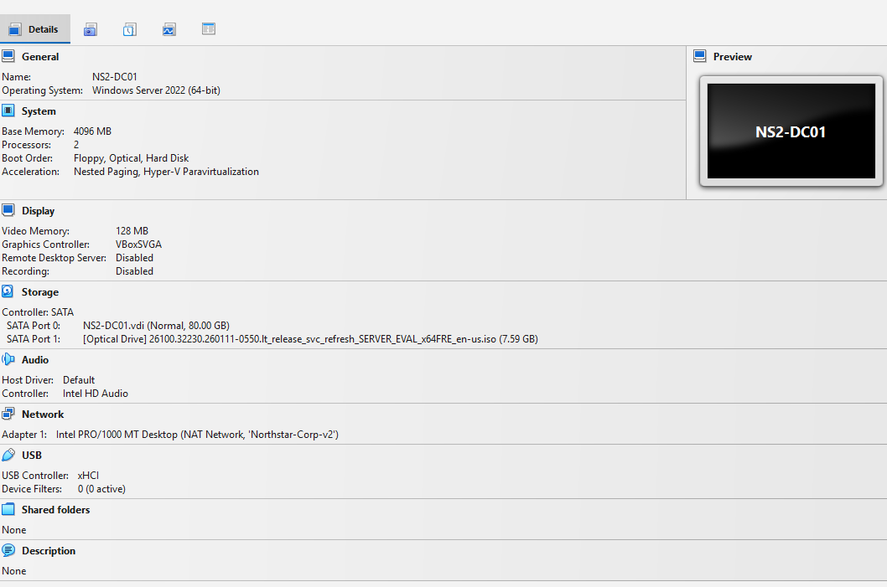
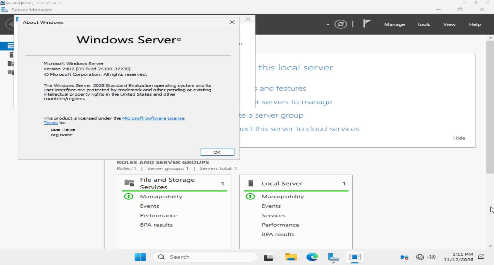

# 03 — Windows Server Installation

## Objective

Deploy a Windows Server VM to provide the foundation for
Active Directory, DNS and user-management exercises.

## Virtual Machine Configuration

| Setting | Value |
| --- | --- |
| VirtualBox VM name | NS2-DC01 |
| VM storage folder | E:\Labs\Northstar-v2\VMs |
| Memory | 4096 MB |
| Virtual processors | 2 |
| Virtual disk | 80 GB VDI |
| Network | Northstar-Corp-v2 |
| Network adapter count | 1 |

## Operating System

- Windows Server 2025 Standard Evaluation
- Desktop Experience
- Version 24H2
- OS build 26100.32230

VirtualBox uses the Windows Server 2022 hardware profile.
The installed operating system was verified separately using winver.

## Installation Process

1. Created the VM and mounted the Windows Server evaluation ISO.
2. Configured its hardware and shared NAT Network connection.
3. Started the manual Windows installation.
4. Selected Standard Evaluation with Desktop Experience.
5. Installed Windows onto the new virtual disk.
6. Set the local Administrator password.
7. Signed in and checked the installed version using winver.

## Verification

- [x] Windows boots to the graphical desktop.
- [x] Administrator sign-in succeeds.
- [x] Server Manager opens.
- [x] Installed edition and build verified.
- [ ] Static IP address configured.
- [ ] Network connectivity tested.
- [ ] Windows activation and updates checked.
- [ ] Active Directory and DNS installed.

## Evidence

## Skills Practised

Virtual machine provisioning, Windows Server installation,
resource allocation and installation verification.

## Next Step

Configure the Windows hostname and static IP address, then
verify connectivity before installing domain services.